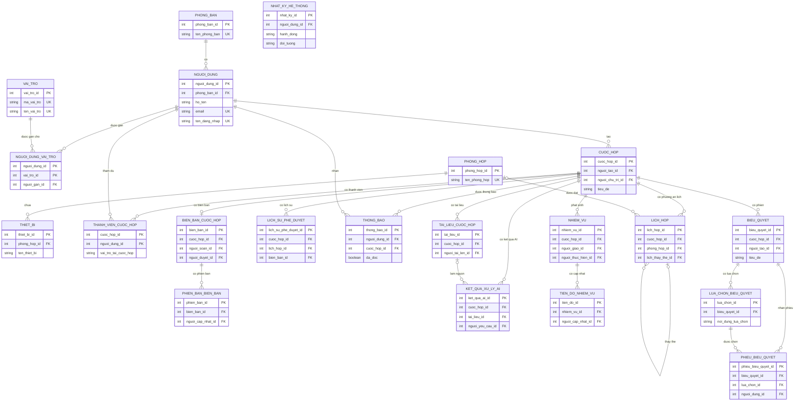

# Thiet ke co so du lieu quan ly cuoc hop

## 1. Pham vi

Tai lieu nay mo ta schema MySQL gom 21 bang duoc khai bao trong [`quan_ly_cuoc_hop_21_bang.sql`](./quan_ly_cuoc_hop_21_bang.sql). Database su dung MySQL 8.x, InnoDB va utf8mb4; cac rang buoc khoa ngoai trong SQL la nguon chuan cho quan he du lieu.

## 2. Danh muc 21 bang

| # | Bang | Package BE | Chuc nang va du lieu chinh |
|---:|---|---|---|
| 1 | `phong_ban` | `phongban` | Danh muc don vi/phong ban; ten, mo ta, trang thai va ngay tao. |
| 2 | `vai_tro` | `phanquyen` | Danh muc vai tro; ma, ten, mo ta va trang thai. |
| 3 | `nguoi_dung` | `nguoidung` | Tai khoan va ho so; phong ban, ma nhan vien, ho ten, email, so dien thoai, ten dang nhap, mat khau da ma hoa va trang thai. |
| 4 | `nguoi_dung_vai_tro` | `phanquyen` | Gan vai tro cho nguoi dung; khoa chinh ghep nguoi dung/vai tro, luu nguoi gan va thoi diem gan. |
| 5 | `phong_hop` | `phonghop` | Danh muc phong hop; vi tri, suc chua, mo ta va trang thai. |
| 6 | `thiet_bi` | `thietbi` | Thiet bi co the gan vao phong; ma, so luong, tinh trang va ghi chu. |
| 7 | `cuoc_hop` | `cuochop` | Thong tin cuoc hop; ma, tieu de, muc tieu, noi dung du kien, loai hinh, nguoi tao/chu tri, trang thai va thoi gian thuc te. |
| 8 | `thanh_vien_cuoc_hop` | `thanhvien` | Thanh vien duoc moi; khoa chinh ghep cuoc hop/nguoi dung, vai tro, phan hoi moi va diem danh. |
| 9 | `lich_hop` | `cuochop` | Cac phuong an va lich da xac nhan; thoi gian, phong, nguoi de xuat/xac nhan, trang thai va lich bi thay the. |
| 10 | `lich_su_phe_duyet` | `pheduyet` | Lich su hanh dong phe duyet cuoc hop/lich/ bien ban; nguoi phe duyet, y kien va thoi diem. |
| 11 | `thong_bao` | `thongbao` | Thong bao theo nguoi nhan; noi dung, loai, trang thai doc va cuoc hop lien quan neu co. |
| 12 | `tai_lieu_cuoc_hop` | `tailieu` | Tep tai len cho cuoc hop; metadata tep, noi dung van ban trich xuat va trang thai xu ly. |
| 13 | `bien_ban_cuoc_hop` | `bienban` | Bien ban duy nhat cho moi cuoc hop; noi dung, nguoi soan/duyet, trang thai va duong dan Word/PDF. |
| 14 | `phien_ban_bien_ban` | `bienban` | Lich su noi dung bien ban; so phien ban, nguoi cap nhat, ghi chu thay doi va ngay tao. |
| 15 | `ket_qua_xu_ly_ai` | `ai` | Yeu cau va ket qua xu ly AI; tai lieu nguon neu co, input/output, trang thai, loi va thoi gian xu ly. |
| 16 | `nhiem_vu` | `nhiemvu` | Cong viec tu cuoc hop; tieu de, nguoi giao/thuc hien, han, uu tien, trang thai va phan tram hoan thanh. |
| 17 | `tien_do_nhiem_vu` | `nhiemvu` | Cac lan cap nhat tien do; nguoi cap nhat, phan tram, noi dung va thoi diem. |
| 18 | `nhat_ky_he_thong` | `nhatky` | Audit log; nguoi dung neu xac dinh duoc, hanh dong, doi tuong, IP, JSON chi tiet va ngay tao. |
| 19 | `bieu_quyet` | `bieuquyet` | Phien bieu quyet cua cuoc hop; tieu de, noi dung, che do, thoi gian, trang thai va nguoi tao. |
| 20 | `lua_chon_bieu_quyet` | `bieuquyet` | Cac phuong an cua mot phien bieu quyet; noi dung, co phai lua chon trang thai va thu tu hien thi. |
| 21 | `phieu_bieu_quyet` | `bieuquyet` | Phieu theo phien va phuong an; nguoi bo phieu co the de trong, ma phieu va thoi diem bieu quyet. |

## 3. Khoa va quan he

- `phong_ban` 1-N `nguoi_dung`; xoa phong ban dat `nguoi_dung.phong_ban_id` thanh NULL.
- `nguoi_dung` N-N `vai_tro` qua `nguoi_dung_vai_tro`; khoa ghep chan viec gan trung vai tro.
- `phong_hop` 1-N `thiet_bi` va 1-N `lich_hop`; xoa phong khong xoa thiet bi/lich ma bo lien ket phong.
- `nguoi_dung` 1-N `cuoc_hop` theo vai tro nguoi tao va nguoi chu tri.
- `cuoc_hop` N-N `nguoi_dung` qua `thanh_vien_cuoc_hop`.
- `cuoc_hop` 1-N `lich_hop`, `lich_su_phe_duyet`, `thong_bao`, `tai_lieu_cuoc_hop`, `ket_qua_xu_ly_ai`, `nhiem_vu` va `bieu_quyet`.
- `lich_hop` co the tham chieu mot `lich_hop` khac de ghi nhan lich thay the.
- `bien_ban_cuoc_hop` toi da mot ban ghi tren moi `cuoc_hop`; moi bien ban co the co nhieu `phien_ban_bien_ban`.
- `lich_su_phe_duyet` co the lien ket lich hop va bien ban; lien ket bien ban duoc them sau khi bang bien ban duoc tao.
- `tai_lieu_cuoc_hop` co the la nguon cho nhieu `ket_qua_xu_ly_ai`.
- `nhiem_vu` 1-N `tien_do_nhiem_vu`.
- `bieu_quyet` 1-N `lua_chon_bieu_quyet` va 1-N `phieu_bieu_quyet`; moi phieu tham chieu lua chon trong chinh phien bieu quyet do bang khoa ngoai ghep.
- `nguoi_dung` duoc tham chieu boi cac vai tro tao, duyet, tai tep, yeu cau AI, giao/thuc hien nhiem vu, cap nhat tien do va bo phieu.

<!-- mermaid-checked: every attribute is `<type> <name> [<key>] ["<description>"]` with at most one of PK/FK/UK, no \n in descriptions, no {} in descriptions, every relationship label is double-quoted -->


## 4. Quy tac rang buoc dang chu y

- Cac bang su dung khoa chinh so nguyen tu tang, tru hai bang lien ket `nguoi_dung_vai_tro` va `thanh_vien_cuoc_hop` su dung khoa chinh ghep.
- Email va ten dang nhap nguoi dung la duy nhat; ma nhan vien la duy nhat neu duoc cung cap. Ma/tieu de vai tro, ten phong hop, ten phong ban va ma thiet bi co rang buoc unique theo SQL.
- Moi cuoc hop chi co toi da mot bien ban; so phien ban la duy nhat trong mot bien ban.
- Lich hop va bieu quyet phai co thoi gian ket thuc sau thoi gian bat dau. So luong suc chua phong hop it nhat 1; phan tram nhiem vu va ty le tham gia bieu quyet trong khoang 0-100.
- Xoa cuoc hop se xoa cac du lieu con duoc cascade; vai tro duoc bao ve boi `RESTRICT` neu dang duoc gan. Cac FK nguoi dung quan trong thuong dung `RESTRICT`, `SET NULL` hoac `CASCADE` tuy vai tro du lieu.
- `nhat_ky_he_thong.chi_tiet` la JSON; `da_doc` va cac co boolean khac duoc luu bang `TINYINT(1)`.

## 5. Huong dan package Java

BE su dung base package `vn.edu.stu.quanlycuochop` va Spring Data JPA. Cac package nghiep vu nen so huu entity/repository cua minh; service, DTO va controller co the nam truc tiep trong package nghiep vu theo cach to chuc hien tai.

| Package nghiep vu | Bang phu trach |
|---|---|
| `phongban` | `phong_ban` |
| `phanquyen` | `vai_tro`, `nguoi_dung_vai_tro` |
| `nguoidung` | `nguoi_dung` |
| `phonghop` | `phong_hop` |
| `thietbi` | `thiet_bi` |
| `cuochop` | `cuoc_hop`, `lich_hop` |
| `thanhvien` | `thanh_vien_cuoc_hop` |
| `pheduyet` | `lich_su_phe_duyet` |
| `thongbao` | `thong_bao` |
| `tailieu` | `tai_lieu_cuoc_hop` |
| `bienban` | `bien_ban_cuoc_hop`, `phien_ban_bien_ban` |
| `ai` | `ket_qua_xu_ly_ai` |
| `nhiemvu` | `nhiem_vu`, `tien_do_nhiem_vu` |
| `nhatky` | `nhat_ky_he_thong` |
| `bieuquyet` | `bieu_quyet`, `lua_chon_bieu_quyet`, `phieu_bieu_quyet` |

Vi du vi tri lop:

```text
vn.edu.stu.quanlycuochop.cuochop
  CuocHopController.java
  CuocHopService.java
  dto/
  entity/
    CuocHop.java
    LichHop.java
  repository/
    CuocHopRepository.java
    LichHopRepository.java
```

Ten entity/repository goi y:

| Bang | Entity | Repository |
|---|---|---|
| `phong_ban` | `PhongBan` | `PhongBanRepository` |
| `vai_tro` | `VaiTro` | `VaiTroRepository` |
| `nguoi_dung` | `NguoiDung` | `NguoiDungRepository` |
| `nguoi_dung_vai_tro` | `NguoiDungVaiTro` | `NguoiDungVaiTroRepository` |
| `phong_hop` | `PhongHop` | `PhongHopRepository` |
| `thiet_bi` | `ThietBi` | `ThietBiRepository` |
| `cuoc_hop` | `CuocHop` | `CuocHopRepository` |
| `thanh_vien_cuoc_hop` | `ThanhVienCuocHop` | `ThanhVienCuocHopRepository` |
| `lich_hop` | `LichHop` | `LichHopRepository` |
| `lich_su_phe_duyet` | `LichSuPheDuyet` | `LichSuPheDuyetRepository` |
| `thong_bao` | `ThongBao` | `ThongBaoRepository` |
| `tai_lieu_cuoc_hop` | `TaiLieuCuocHop` | `TaiLieuCuocHopRepository` |
| `bien_ban_cuoc_hop` | `BienBanCuocHop` | `BienBanCuocHopRepository` |
| `phien_ban_bien_ban` | `PhienBanBienBan` | `PhienBanBienBanRepository` |
| `ket_qua_xu_ly_ai` | `KetQuaXuLyAi` | `KetQuaXuLyAiRepository` |
| `nhiem_vu` | `NhiemVu` | `NhiemVuRepository` |
| `tien_do_nhiem_vu` | `TienDoNhiemVu` | `TienDoNhiemVuRepository` |
| `nhat_ky_he_thong` | `NhatKyHeThong` | `NhatKyHeThongRepository` |
| `bieu_quyet` | `BieuQuyet` | `BieuQuyetRepository` |
| `lua_chon_bieu_quyet` | `LuaChonBieuQuyet` | `LuaChonBieuQuyetRepository` |
| `phieu_bieu_quyet` | `PhieuBieuQuyet` | `PhieuBieuQuyetRepository` |

### Luu y khi map JPA

- Dung `@Table(name = "...")` va `@Column(name = "...")` theo dung ten SQL; khong doi ten cot schema bang quy uoc camelCase.
- Map khoa ghep `nguoi_dung_vai_tro` va `thanh_vien_cuoc_hop` bang `@EmbeddedId`/`@Embeddable` hoac `@IdClass`.
- `phieu_bieu_quyet` co khoa ngoai ghep `(lua_chon_id, bieu_quyet_id)` toi `lua_chon_bieu_quyet`; entity can map dung ca hai cot de giu rang buoc.
- Dung `Long` cho `BIGINT`, `BigDecimal` cho `DECIMAL`, `LocalDateTime` cho `DATETIME`, `Boolean`/`Integer` cho `TINYINT(1)` theo convention du an.
- Dat `spring.jpa.hibernate.ddl-auto=validate` hien tai; SQL la nguon tao schema, JPA chi kiem tra mapping. Khong cho Hibernate tu dong tao schema tren database nay.
- `mat_khau_ma_hoa` can luu hash mat khau, khong luu mat khau ro. Cac truong ho ten/email/dien thoai va noi dung hop/tai lieu la du lieu nhay cam; can gioi han quyen truy cap va bao ve file luu tru.

## 6. Cau hinh va tinh trang truy cap du lieu hien tai

BE ket noi MySQL qua JDBC va su dung Spring Data JPA/Hibernate. Cau hinh hien tai dat Hibernate o che do `validate`, SQL schema la nguon chinh; chua thay migration tool nhu Flyway/Liquibase, cache provider, repository JPA hoac entity nghiep vu trong source BE. Cac bang package hien dang duoc scaffold theo mien nghiep vu; package/entity/repository scaffold khong co nghia la nghiep vu CRUD da duoc trien khai.

## 7. Nguon schema

- Schema: [`quan_ly_cuoc_hop_21_bang.sql`](./quan_ly_cuoc_hop_21_bang.sql)
- Cau hinh BE: `BE/src/main/resources/application.properties`
- Ma nguon BE: `BE/src/main/java/vn/edu/stu/quanlycuochop/`
