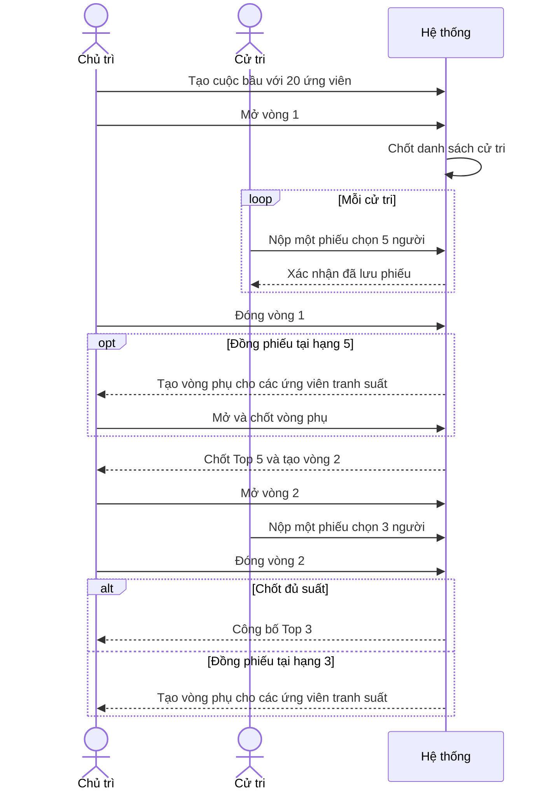
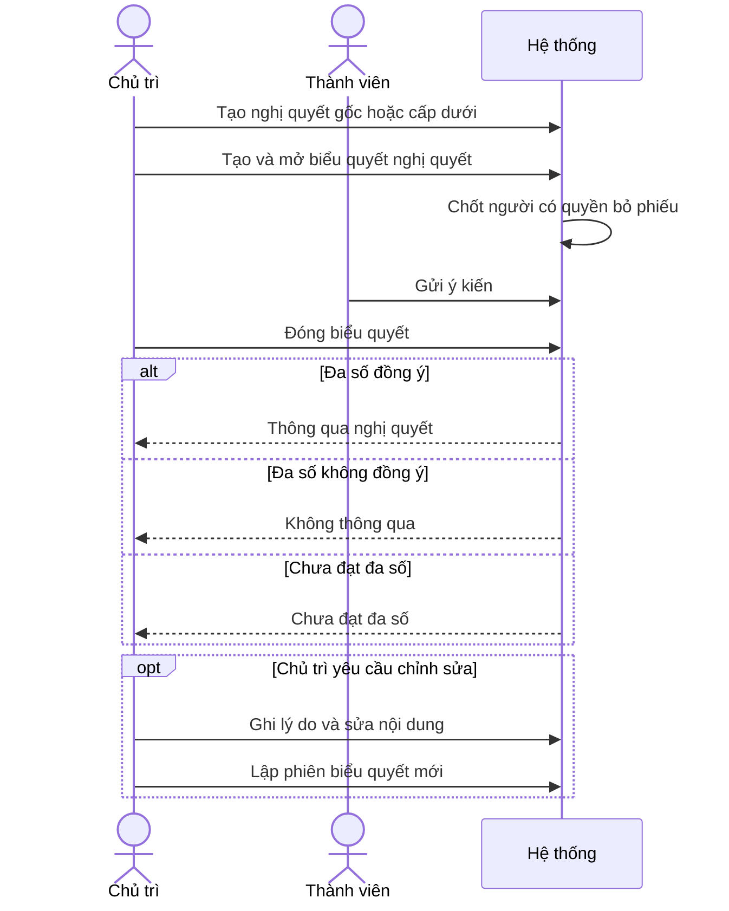
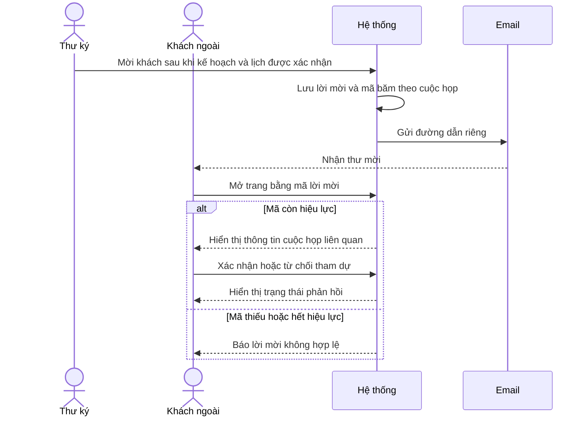
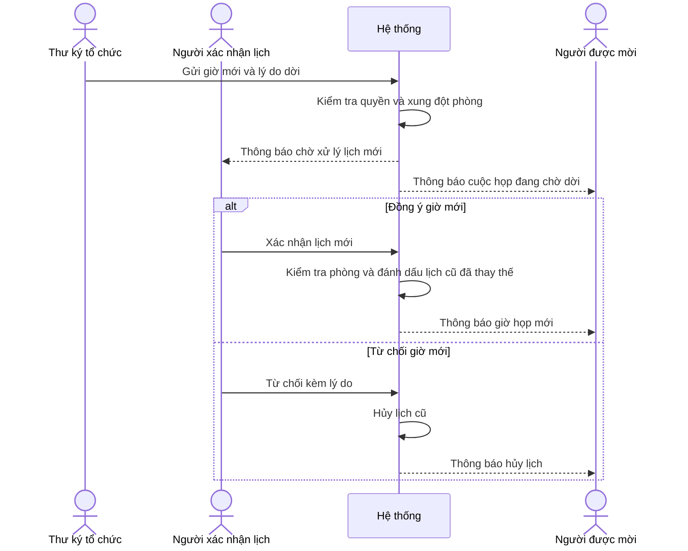

# Bầu chọn, nghị quyết, khách mời và dời lịch

Thay đổi dựa trên nhánh `main` tại commit `52e9a642d32c11a961931d121d11276a9d59dcde`. Các luồng mới xuất phát từ hồ sơ cuộc họp, giữ quan hệ với kế hoạch đã duyệt và dùng phân quyền theo cuộc họp.

## Cài đặt

1. Sao lưu database hiện có. Khi tạo database mới, nhập [schema hiện tại](../database/quan_ly_cuoc_hop_schema.sql) trước.
2. Chạy [migration MySQL](../database/migrations/20261122_nghiep_vu_cuoc_hop.sql) một lần trên database của ứng dụng. Spring dùng `ddl-auto=none`.
3. Dùng JDK 25 để chạy `mvnw test` rồi khởi động backend. Trong thư mục `FE`, chạy `npm ci` và `npm run dev`.
4. Khi chạy trên server, đặt `APP_URL_CONG_KHAI` bằng URL HTTPS của frontend và định tuyến `/loi-moi-khach` về `index.html`. Chạy profile `gmail` với SMTP và bật `app.email.enabled` để gửi thông báo thay đổi lịch. Localhost dùng để kiểm thử trên cùng máy.

## 1. Bầu chọn Top 5 rồi Top 3

Chủ trì chọn đúng 20 thành viên **đã điểm danh và còn có mặt**. Danh sách cử tri được chốt lại khi mở từng vòng. Vòng 1 chọn đúng 5 ứng viên mỗi phiếu và chốt 5 người. Vòng 2 chọn đúng 3 ứng viên trong danh sách 5 người đã chốt. Mỗi ứng viên được chọn nhận một lượt và phiếu được khóa sau khi nộp.

| Bảng | Dữ liệu |
|---|---|
| `cuoc_bau` | Tiêu đề, cuộc họp và chủ trì lập cuộc bầu |
| `vong_bau` | Vòng trước, số vòng, số lựa chọn trên phiếu, số suất và trạng thái |
| `ung_vien_vong_bau` | Thành viên ứng cử, tên tại thời điểm lập vòng, lượt chọn và kết quả |
| `cu_tri_vong_bau` | Danh sách cử tri đã chốt khi mở vòng |
| `phieu_bau` | Một phiếu duy nhất cho mỗi cử tri trong từng vòng |
| `lua_chon_phieu_bau` | Từng ứng viên được chọn trong một phiếu |

Đồng phiếu tại ranh giới chốt suất sẽ tạo vòng phụ với đúng các ứng viên đang tranh suất và số suất còn thiếu. Kết quả vòng phụ được ghi trở lại vòng chính. Chủ trì mở vòng 2 khi Top 5 đã chốt. Kết quả công bố hiển thị số lượt chọn, trong khi người dùng xem được trạng thái nộp phiếu của chính mình. Phiếu hiện lưu danh tính cử tri trong database. Vòng đóng khi chưa có phiếu được ghi là đã hủy, chủ trì có thể tạo cuộc bầu mới.

## 2. Nghị quyết bốn cấp

Bảng `nghi_quyet` có khóa cha tự tham chiếu trong cùng cuộc họp và tối đa bốn cấp. Từng nghị quyết có kết quả riêng. Chủ trì tạo nghị quyết trong tab **Nghị quyết**, sau đó chọn nghị quyết nháp khi tạo phiên ở tab **Biểu quyết**. Phiên lưu nội dung của nghị quyết tại thời điểm tạo để xem lại sau khi sửa nội dung cho lần bỏ phiếu tiếp theo.

Đa số được tính theo **số người có quyền bỏ phiếu đã chốt khi mở phiên**. Trên 50% chọn **Đồng ý** thì thông qua. Trên 50% chọn **Không đồng ý** thì không thông qua. Nếu cả hai đều không đạt ngưỡng thì hiển thị **Chưa đạt đa số**. Chủ trì có thể yêu cầu chỉnh sửa kèm lý do, cập nhật bản nháp và mở phiên mới. Kết quả của mỗi lần bỏ phiếu vẫn lưu với phiên cũ.

## 3. Trang lời mời khách ngoài

Email gửi đường dẫn riêng cho từng khách và cuộc họp. Trang hiển thị tiêu đề, nội dung đã duyệt, chủ trì, giờ họp và địa điểm. Khách có thể xác nhận hoặc từ chối mà không cần tài khoản nội bộ. Đường dẫn họp trực tuyến trên trang hiển thị sau khi khách xác nhận. Khách đã nhận email từ trước bản nâng cấp có thể được gửi lại lời mời qua form mời khách bằng email cũ.

BE lưu giá trị băm của mã mời. Mã nằm ở phần fragment của URL frontend và được gửi qua header khi gọi API. Trang lấy lịch hiện hành và thông báo khi lịch đang dời hoặc đã hủy.

## 4. Dời lịch theo kế hoạch đã duyệt

Trong hồ sơ, thư ký tổ chức chọn **Lịch và kế hoạch → Dời lịch họp**, nhập giờ mới và lý do. Luồng dùng phòng hiện tại và ghi một lịch mới liên kết với lịch cũ. Người được giao duyệt lịch xử lý từ **Lịch họp**. Thời gian chờ xác nhận tạm khóa việc mở cuộc họp và gửi thư mời mới. Hệ thống kiểm tra lại xung đột phòng khi xác nhận.

Nếu đồng ý, lịch mới có hiệu lực và lịch cũ thành **Đã thay thế**. Nếu từ chối, lịch mới thành **Từ chối** và lịch cũ thành **Đã hủy**. Hồ sơ kế hoạch vẫn ở trạng thái đã duyệt. Trạng thái lịch hiển thị trong ứng dụng và trang khách. Email báo dời, xác nhận hoặc hủy được gửi khi SMTP được bật.

## Các tình huống kiểm thử nghiệp vụ

| Luồng | Tình huống | Kết quả |
|---|---|---|
| Bầu chọn | Gửi hai phiếu đồng thời cho cùng cử tri | Chỉ một phiếu được lưu |
| Bầu chọn | Đồng phiếu tại hạng 5, các suất khác đã rõ | Tạo vòng phụ cho các ứng viên còn tranh suất |
| Bầu chọn | Mở vòng 2 | Danh sách gồm đúng 5 ứng viên đã chốt |
| Nghị quyết | 11/20 người có quyền bỏ phiếu chọn Đồng ý | Thông qua |
| Nghị quyết | 11/20 chọn Không đồng ý | Không thông qua, chủ trì có thể yêu cầu sửa |
| Nghị quyết | 10/20 chọn Đồng ý hoặc thêm nghị quyết cấp 5 | Chưa đạt đa số, cấp 5 bị API từ chối |
| Khách ngoài | Mở đường dẫn hoặc dùng mã không hợp lệ | Hiển thị đúng lời mời hoặc trả lỗi 404 |
| Dời lịch | Xác nhận khi phòng đã bị đặt trùng | Lịch mới chưa có hiệu lực |
| Dời lịch | Từ chối giờ mới | Lịch cũ bị hủy, kế hoạch giữ trạng thái đã duyệt |
